# Schemify-Themes

The [spicetify-themes](https://github.com/spicetify/spicetify-themes) catalogue for [Schemify](https://github.com/OpenFAT/Schemify): 15 themes and 115 colour schemes, each recoloring the editor's chrome and the schematic canvas. Pick one from **View → Themes**.

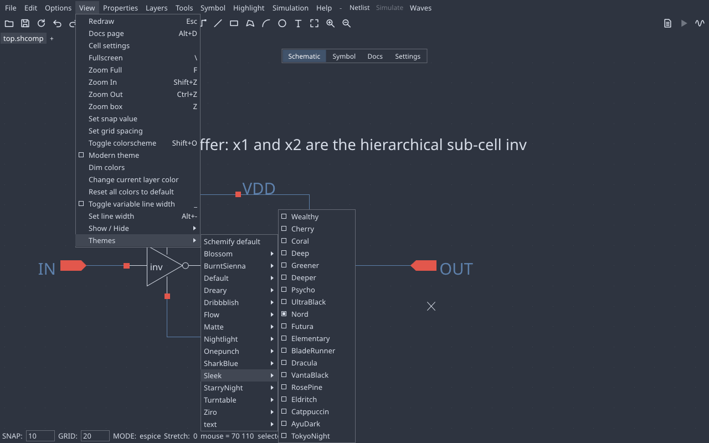

## Install

Add the plugin to your `init.lua`, then run `schemify pack sync`:

```lua
schemify.pack.add {
  { src = "https://github.com/OpenFAT/Schemify-Themes.git" },
}
```

Choose a theme from **View → Themes → *theme* → *scheme***, or run its command (listed under each screenshot below). **Schemify default** returns to the editor's own look.

### Keep a theme across restarts

The plugin does not remember your choice. To start with a theme, load the plugin on that theme's command and run the command at startup:

```lua
schemify.pack.add {
  { src = "https://github.com/OpenFAT/Schemify-Themes.git", lazy = { cmd = "theme.sleek.nord" } },
}
schemify.cmd("theme.sleek.nord")
```

## How the themes are made

A spicetify scheme is a list of named colours for Spotify (`main`, `sidebar`, `card`, `text`, `subtext`, `button`, and so on). [`tools/spicetify.py`](tools/spicetify.py) maps them onto the roles of Schemify's Modern preset ([`themes/template.records`](themes/template.records)):

- Panels and cards keep the scheme's own surfaces, text and accent.
- The canvas uses the scheme's background, its accent for wires, its text for labels, and a second scheme colour for symbols.
- The result is one row of [`themes/palettes.tsv`](themes/palettes.tsv).

Each scheme then has to pass Schemify's theme gate ([`tools/check_theme.py`](tools/check_theme.py), from Schemify's `schemify-theme` skill):
- WCAG contrast for canvas layers and chrome text.
- A visible grid that stays dimmer than the circuit.
- Net highlights that stay distinct under deuteranopia and protanopia.

When a colour misses a threshold, the generator moves it toward white or black until it passes, so its hue stays the theme's. When a surface makes the scheme's text unreadable, the surface moves back toward the background instead. When Modern's highlight set clashes with a background, a greedy search picks a new set. The gate's two-accent budget is reported but not enforced, because many of these themes are colourful by design.

The plugin embeds the template and the palette table (about 90 KB of wasm) and fills in the chosen scheme at run time.

### Regenerating

```sh
git clone https://github.com/spicetify/spicetify-themes /tmp/spicetify-themes   # revision used: see tools/spicetify.rev
python3 tools/spicetify.py /tmp/spicetify-themes                                 # rewrites themes/palettes.tsv
curl -fsSL -o ui.records https://raw.githubusercontent.com/OpenFAT/Schemify/main/ui/default-plugin/ui.records
python3 tools/gate.py ui.records                                                 # every scheme must pass
./build.sh                                                                       # rebuilds schemify_themes.wasm (Rust 1.95, wasm32)
```

To regenerate the screenshots, copy [`tools/shots.rs`](tools/shots.rs) into a Schemify checkout as `crates/view/app/tests/theme_shots.rs`, then make `Session::open_with` public in `tests/common/mod.rs`. Then run:

```sh
THEMES_DIR=$PWD cargo test -p schemify-app --test theme_shots
```

This loads the built plugin through the real editor, applies every scheme, checks that the canvas shows that scheme's background, and writes the PNGs. Downscale them into `screenshots/thumbs/` (640 px wide).

## Gallery

### Blossom

From spicetify's [Blossom](https://github.com/spicetify/spicetify-themes/tree/master/Blossom) by [Robatortas](https://github.com/Robatortas).

<table>
<tr><td align="center">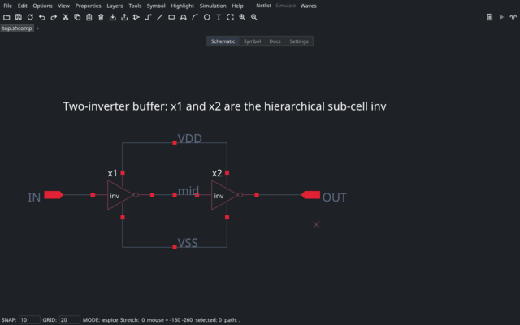<br><b>dark</b><br><code>theme.blossom.dark</code></td></tr>
</table>

### BurntSienna

From spicetify's [BurntSienna](https://github.com/spicetify/spicetify-themes/tree/master/BurntSienna) by [pjaspinski](https://github.com/pjaspinski).

<table>
<tr><td align="center">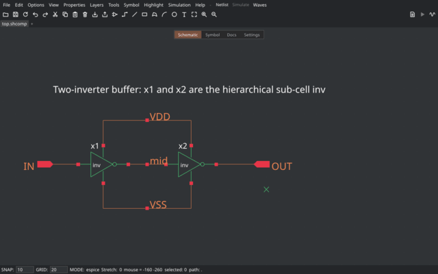<br><b>Base</b><br><code>theme.burntsienna.base</code></td></tr>
</table>

### Default

From spicetify's [Default](https://github.com/spicetify/spicetify-themes/tree/master/Default) by [Blacksuan19](https://github.com/Blacksuan19).

<table>
<tr><td align="center">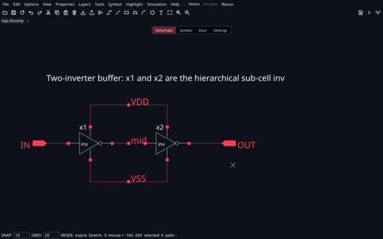<br><b>Ocean</b><br><code>theme.default.ocean</code></td></tr>
</table>

### Dreary

From spicetify's [Dreary](https://github.com/spicetify/spicetify-themes/tree/master/Dreary) by [CharlieS1103](https://github.com/CharlieS1103).

<table>
<tr><td align="center">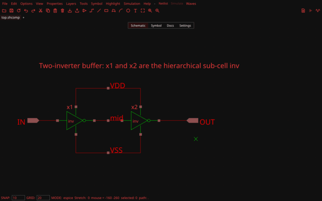<br><b>Psycho</b><br><code>theme.dreary.psycho</code></td><td align="center">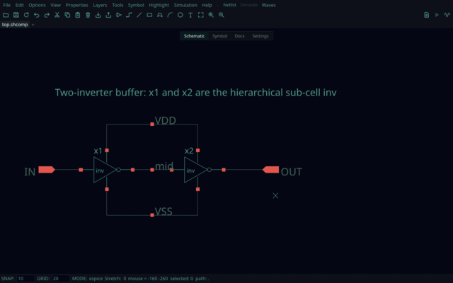<br><b>Deeper</b><br><code>theme.dreary.deeper</code></td><td align="center">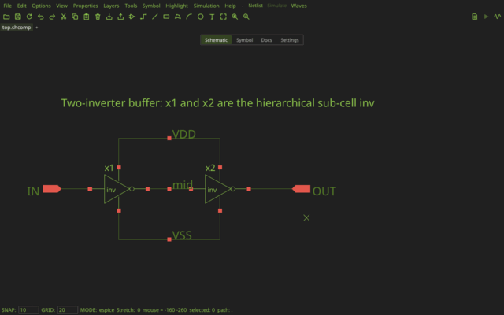<br><b>BIB</b><br><code>theme.dreary.bib</code></td></tr>
<tr><td align="center">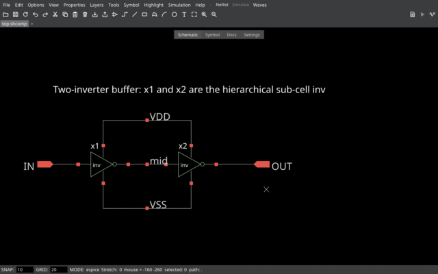<br><b>Mono</b><br><code>theme.dreary.mono</code></td><td align="center">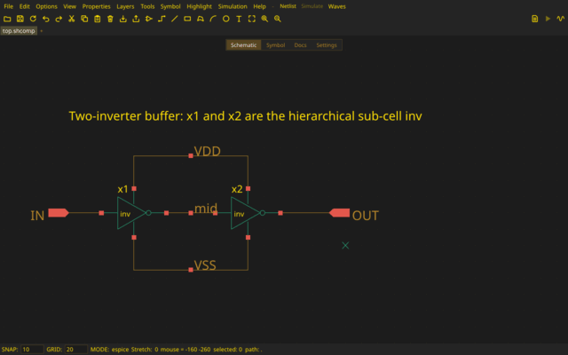<br><b>Golden</b><br><code>theme.dreary.golden</code></td><td align="center">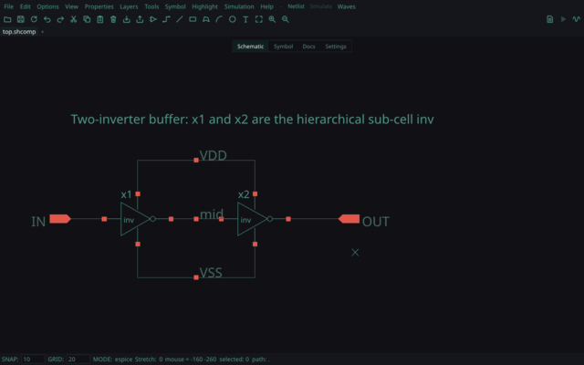<br><b>Graytone-Blue</b><br><code>theme.dreary.graytone_blue</code></td></tr>
</table>

### Dribbblish

From spicetify's [Dribbblish](https://github.com/spicetify/spicetify-themes/tree/master/Dribbblish) by [khanhas](https://github.com/khanhas), [harbassan](https://github.com/harbassan).

<table>
<tr><td align="center">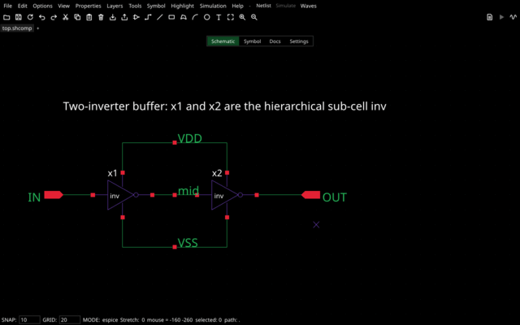<br><b>base</b><br><code>theme.dribbblish.base</code></td><td align="center">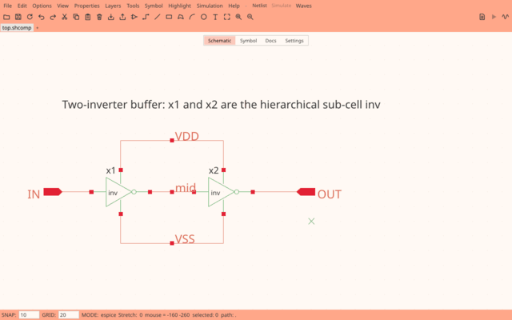<br><b>white</b><br><code>theme.dribbblish.white</code></td><td align="center">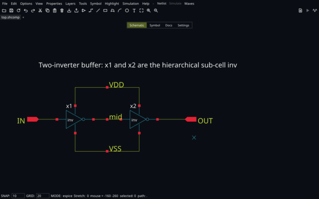<br><b>dark</b><br><code>theme.dribbblish.dark</code></td></tr>
<tr><td align="center">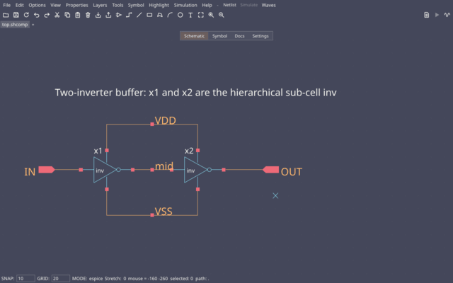<br><b>dracula</b><br><code>theme.dribbblish.dracula</code></td><td align="center">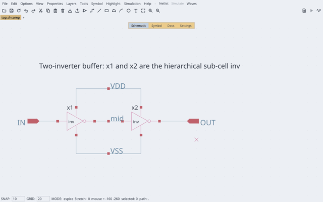<br><b>nord-light</b><br><code>theme.dribbblish.nord_light</code></td><td align="center">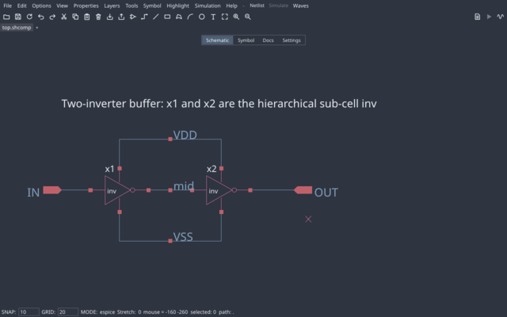<br><b>nord-dark</b><br><code>theme.dribbblish.nord_dark</code></td></tr>
<tr><td align="center">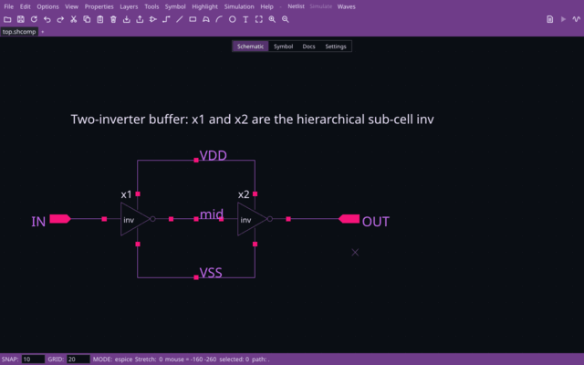<br><b>purple</b><br><code>theme.dribbblish.purple</code></td><td align="center">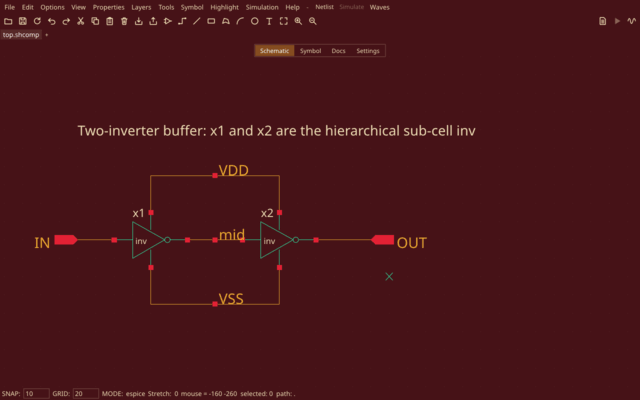<br><b>samurai</b><br><code>theme.dribbblish.samurai</code></td><td align="center">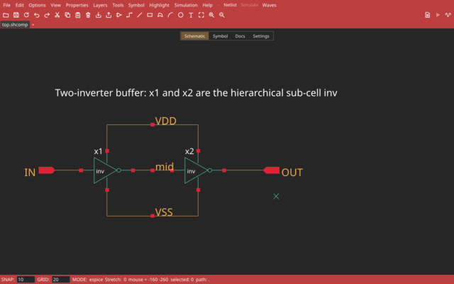<br><b>beach-sunset</b><br><code>theme.dribbblish.beach_sunset</code></td></tr>
<tr><td align="center">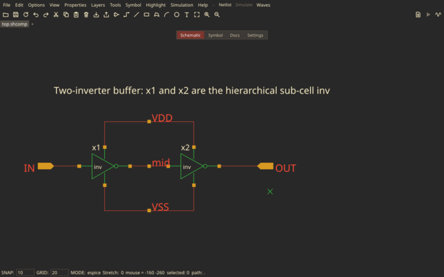<br><b>gruvbox</b><br><code>theme.dribbblish.gruvbox</code></td><td align="center">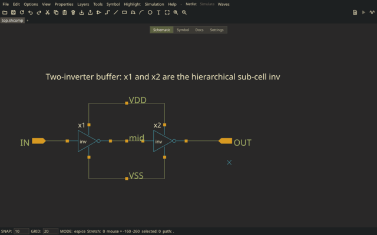<br><b>gruvbox-material-dark</b><br><code>theme.dribbblish.gruvbox_material_dark</code></td><td align="center">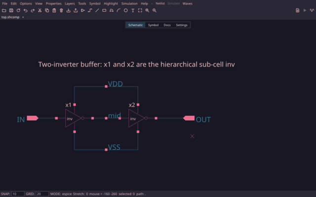<br><b>rosepine</b><br><code>theme.dribbblish.rosepine</code></td></tr>
<tr><td align="center">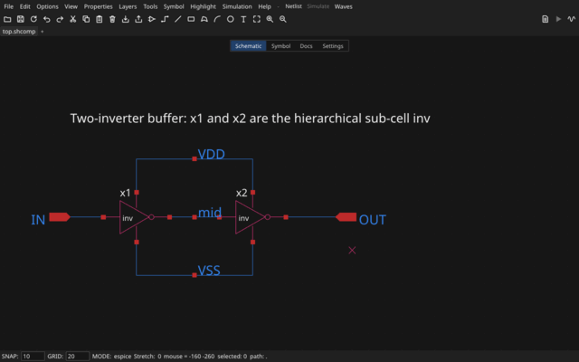<br><b>lunar</b><br><code>theme.dribbblish.lunar</code></td><td align="center">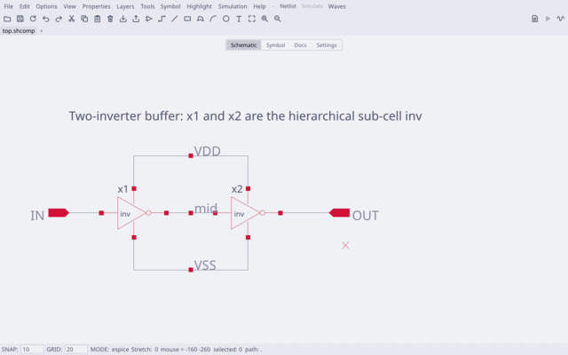<br><b>catppuccin-latte</b><br><code>theme.dribbblish.catppuccin_latte</code></td><td align="center">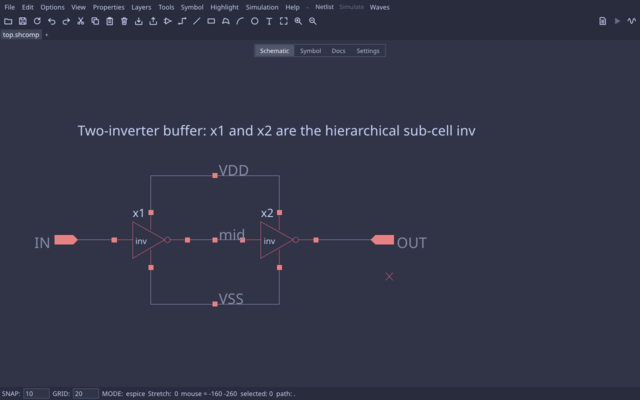<br><b>catppuccin-frappe</b><br><code>theme.dribbblish.catppuccin_frappe</code></td></tr>
<tr><td align="center">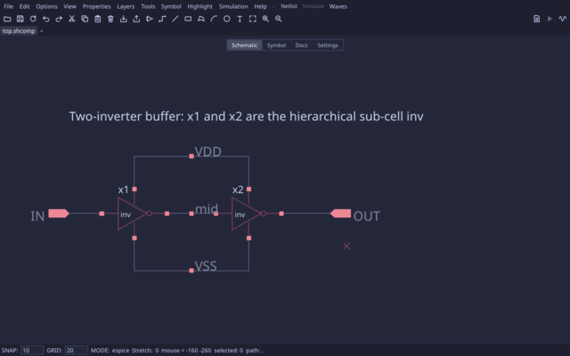<br><b>catppuccin-macchiato</b><br><code>theme.dribbblish.catppuccin_macchiato</code></td><td align="center">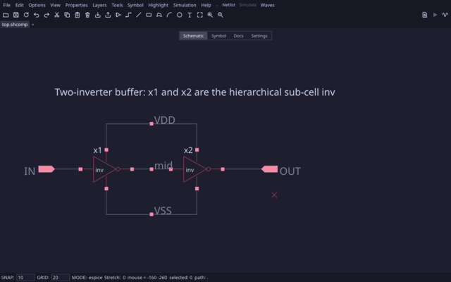<br><b>catppuccin-mocha</b><br><code>theme.dribbblish.catppuccin_mocha</code></td><td align="center">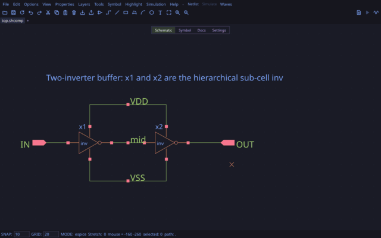<br><b>tokyo-night</b><br><code>theme.dribbblish.tokyo_night</code></td></tr>
<tr><td align="center">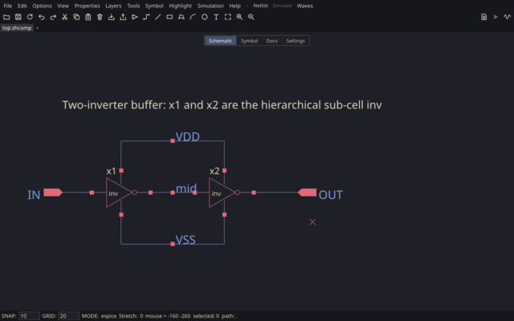<br><b>kanagawa</b><br><code>theme.dribbblish.kanagawa</code></td></tr>
</table>

### Flow

From spicetify's [Flow](https://github.com/spicetify/spicetify-themes/tree/master/Flow) by [Ian Liao](https://github.com/ian-Liaozy), [Victoria Zhang](https://github.com/Ruixi-Zhang), [Yu Sung Lee](https://github.com/yslDevelop), [Alex Casieri](https://github.com/alexcasieri30).

<table>
<tr><td align="center">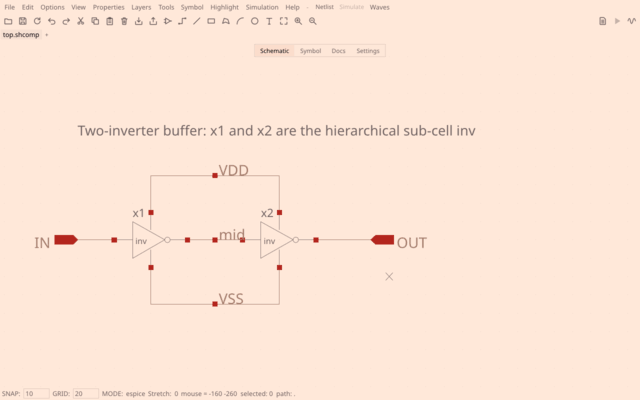<br><b>Pink</b><br><code>theme.flow.pink</code></td><td align="center">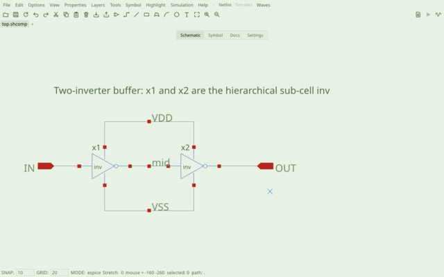<br><b>Green</b><br><code>theme.flow.green</code></td><td align="center">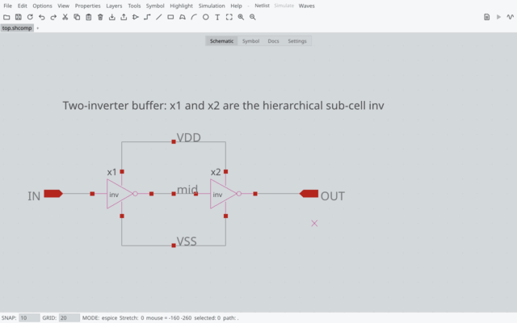<br><b>Silver</b><br><code>theme.flow.silver</code></td></tr>
<tr><td align="center">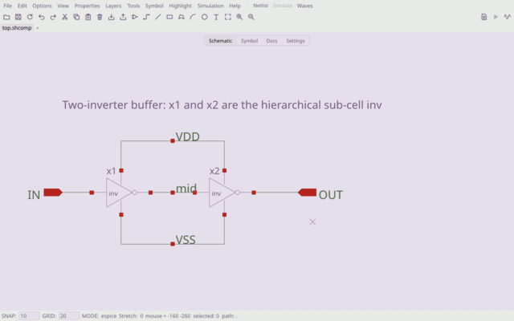<br><b>Violet</b><br><code>theme.flow.violet</code></td><td align="center">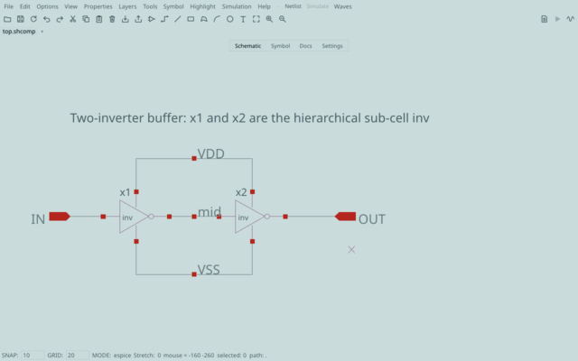<br><b>Ocean</b><br><code>theme.flow.ocean</code></td></tr>
</table>

### Matte

From spicetify's [Matte](https://github.com/spicetify/spicetify-themes/tree/master/Matte) by [darkthemer](https://github.com/darkthemer).

<table>
<tr><td align="center">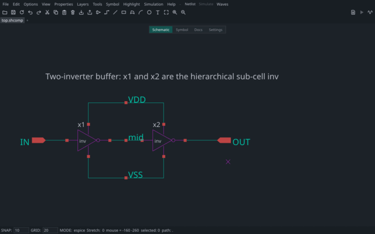<br><b>matte</b><br><code>theme.matte.matte</code></td><td align="center">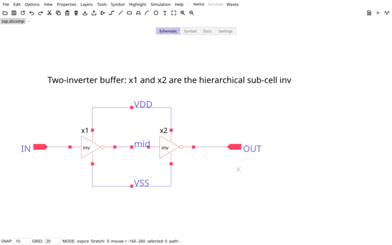<br><b>periwinkle</b><br><code>theme.matte.periwinkle</code></td><td align="center">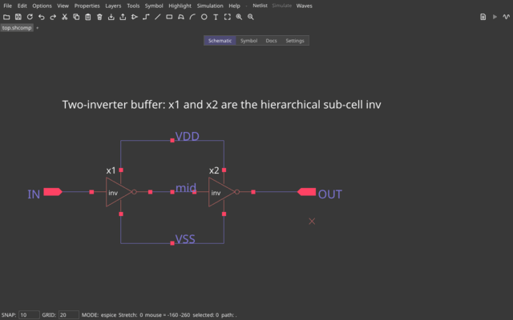<br><b>periwinkle-dark</b><br><code>theme.matte.periwinkle_dark</code></td></tr>
<tr><td align="center">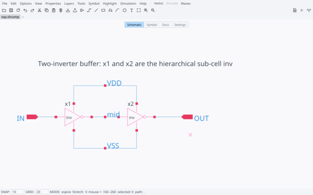<br><b>porcelain</b><br><code>theme.matte.porcelain</code></td><td align="center">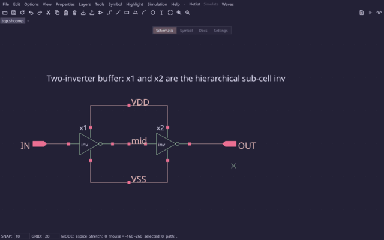<br><b>rose-pine-moon</b><br><code>theme.matte.rose_pine_moon</code></td><td align="center">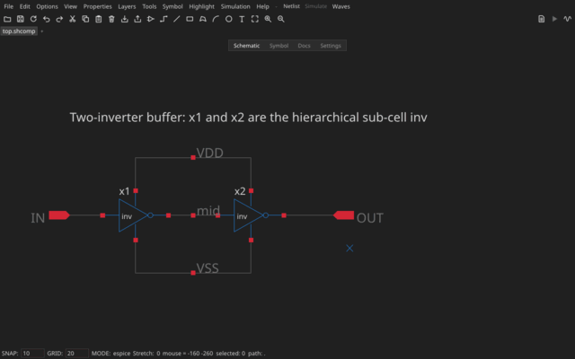<br><b>gray-dark1</b><br><code>theme.matte.gray_dark1</code></td></tr>
<tr><td align="center">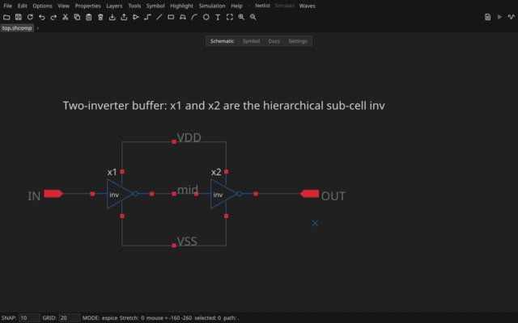<br><b>gray-dark2</b><br><code>theme.matte.gray_dark2</code></td><td align="center">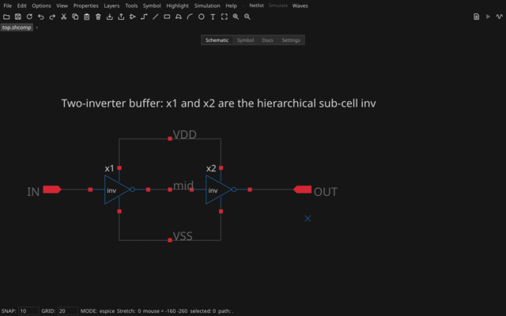<br><b>gray-dark3</b><br><code>theme.matte.gray_dark3</code></td><td align="center">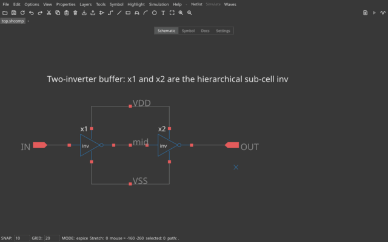<br><b>gray</b><br><code>theme.matte.gray</code></td></tr>
<tr><td align="center">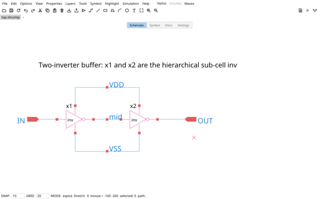<br><b>gray-light</b><br><code>theme.matte.gray_light</code></td></tr>
</table>

### Nightlight

From spicetify's [Nightlight](https://github.com/spicetify/spicetify-themes/tree/master/Nightlight).

<table>
<tr><td align="center">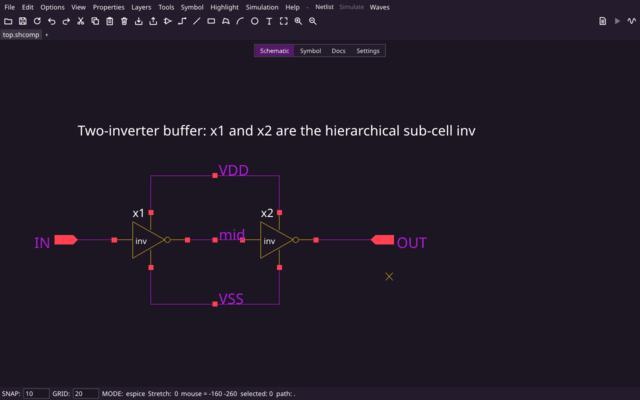<br><b>Nightlight Colors</b><br><code>theme.nightlight.nightlight_colors</code></td></tr>
</table>

### Onepunch

From spicetify's [Onepunch](https://github.com/spicetify/spicetify-themes/tree/master/Onepunch) by [okarin001](https://github.com/okarin001).

<table>
<tr><td align="center">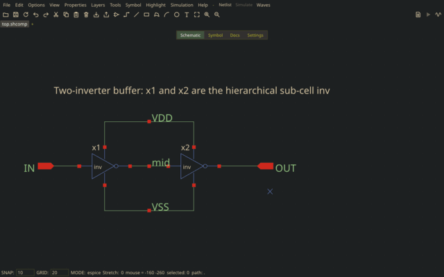<br><b>dark</b><br><code>theme.onepunch.dark</code></td><td align="center">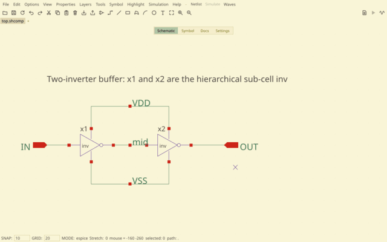<br><b>light</b><br><code>theme.onepunch.light</code></td><td align="center">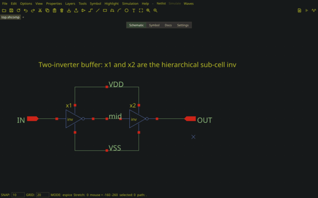<br><b>legacy</b><br><code>theme.onepunch.legacy</code></td></tr>
</table>

### SharkBlue

From spicetify's [SharkBlue](https://github.com/spicetify/spicetify-themes/tree/master/SharkBlue) by [Mr Biscuit](https://github.com/MrBiscuit921).

<table>
<tr><td align="center">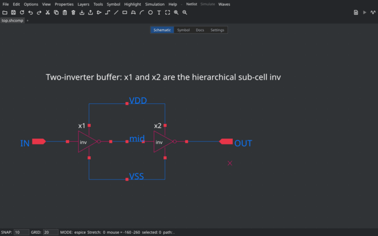<br><b>Base</b><br><code>theme.sharkblue.base</code></td></tr>
</table>

### Sleek

From spicetify's [Sleek](https://github.com/spicetify/spicetify-themes/tree/master/Sleek) by [harbassan](https://github.com/harbassan).

<table>
<tr><td align="center">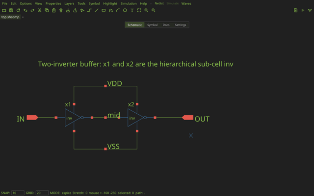<br><b>Wealthy</b><br><code>theme.sleek.wealthy</code></td><td align="center"><br><b>Cherry</b><br><code>theme.sleek.cherry</code></td><td align="center"><br><b>Coral</b><br><code>theme.sleek.coral</code></td></tr>
<tr><td align="center"><br><b>Deep</b><br><code>theme.sleek.deep</code></td><td align="center"><br><b>Greener</b><br><code>theme.sleek.greener</code></td><td align="center"><br><b>Deeper</b><br><code>theme.sleek.deeper</code></td></tr>
<tr><td align="center"><br><b>Psycho</b><br><code>theme.sleek.psycho</code></td><td align="center"><br><b>UltraBlack</b><br><code>theme.sleek.ultrablack</code></td><td align="center"><br><b>Nord</b><br><code>theme.sleek.nord</code></td></tr>
<tr><td align="center"><br><b>Futura</b><br><code>theme.sleek.futura</code></td><td align="center"><br><b>Elementary</b><br><code>theme.sleek.elementary</code></td><td align="center"><br><b>BladeRunner</b><br><code>theme.sleek.bladerunner</code></td></tr>
<tr><td align="center"><br><b>Dracula</b><br><code>theme.sleek.dracula</code></td><td align="center"><br><b>VantaBlack</b><br><code>theme.sleek.vantablack</code></td><td align="center"><br><b>RosePine</b><br><code>theme.sleek.rosepine</code></td></tr>
<tr><td align="center"><br><b>Eldritch</b><br><code>theme.sleek.eldritch</code></td><td align="center"><br><b>Catppuccin</b><br><code>theme.sleek.catppuccin</code></td><td align="center"><br><b>AyuDark</b><br><code>theme.sleek.ayudark</code></td></tr>
<tr><td align="center"><br><b>TokyoNight</b><br><code>theme.sleek.tokyonight</code></td></tr>
</table>

### StarryNight

From spicetify's [StarryNight](https://github.com/spicetify/spicetify-themes/tree/master/StarryNight) by [Brandon Chen](https://github.com/b-chen00), [Julissa Laignelet](https://github.com/laignelet16).

<table>
<tr><td align="center"><br><b>Base</b><br><code>theme.starrynight.base</code></td><td align="center"><br><b>Cotton-candy</b><br><code>theme.starrynight.cotton_candy</code></td><td align="center"><br><b>Forest</b><br><code>theme.starrynight.forest</code></td></tr>
<tr><td align="center"><br><b>Galaxy</b><br><code>theme.starrynight.galaxy</code></td><td align="center"><br><b>Orange</b><br><code>theme.starrynight.orange</code></td><td align="center"><br><b>Sky</b><br><code>theme.starrynight.sky</code></td></tr>
<tr><td align="center"><br><b>Sunrise</b><br><code>theme.starrynight.sunrise</code></td></tr>
</table>

### Turntable

From spicetify's [Turntable](https://github.com/spicetify/spicetify-themes/tree/master/Turntable) by [Grason Chan](https://github.com/grasonchan).

<table>
<tr><td align="center"><br><b>turntable</b><br><code>theme.turntable.turntable</code></td></tr>
</table>

### Ziro

From spicetify's [Ziro](https://github.com/spicetify/spicetify-themes/tree/master/Ziro) by [schnensch0](https://github.com/schnensch0).

<table>
<tr><td align="center"><br><b>blue-dark</b><br><code>theme.ziro.blue_dark</code></td><td align="center"><br><b>blue-light</b><br><code>theme.ziro.blue_light</code></td><td align="center"><br><b>gray-dark</b><br><code>theme.ziro.gray_dark</code></td></tr>
<tr><td align="center"><br><b>gray-light</b><br><code>theme.ziro.gray_light</code></td><td align="center"><br><b>green-dark</b><br><code>theme.ziro.green_dark</code></td><td align="center"><br><b>green-light</b><br><code>theme.ziro.green_light</code></td></tr>
<tr><td align="center"><br><b>orange-dark</b><br><code>theme.ziro.orange_dark</code></td><td align="center"><br><b>orange-light</b><br><code>theme.ziro.orange_light</code></td><td align="center"><br><b>purple-dark</b><br><code>theme.ziro.purple_dark</code></td></tr>
<tr><td align="center"><br><b>purple-light</b><br><code>theme.ziro.purple_light</code></td><td align="center"><br><b>red-dark</b><br><code>theme.ziro.red_dark</code></td><td align="center"><br><b>red-light</b><br><code>theme.ziro.red_light</code></td></tr>
<tr><td align="center"><br><b>rose-pine</b><br><code>theme.ziro.rose_pine</code></td><td align="center"><br><b>rose-pine-moon</b><br><code>theme.ziro.rose_pine_moon</code></td><td align="center"><br><b>rose-pine-dawn</b><br><code>theme.ziro.rose_pine_dawn</code></td></tr>
<tr><td align="center"><br><b>tokyo-night</b><br><code>theme.ziro.tokyo_night</code></td></tr>
</table>

### text

From spicetify's [text](https://github.com/spicetify/spicetify-themes/tree/master/text) by [darkthemer](https://github.com/darkthemer).

<table>
<tr><td align="center"><br><b>Spotify</b><br><code>theme.text.spotify</code></td><td align="center"><br><b>Spicetify</b><br><code>theme.text.spicetify</code></td><td align="center"><br><b>CatppuccinMocha</b><br><code>theme.text.catppuccinmocha</code></td></tr>
<tr><td align="center"><br><b>CatppuccinMacchiato</b><br><code>theme.text.catppuccinmacchiato</code></td><td align="center"><br><b>CatppuccinLatte</b><br><code>theme.text.catppuccinlatte</code></td><td align="center"><br><b>Dracula</b><br><code>theme.text.dracula</code></td></tr>
<tr><td align="center"><br><b>Gruvbox</b><br><code>theme.text.gruvbox</code></td><td align="center"><br><b>GruvboxHard</b><br><code>theme.text.gruvboxhard</code></td><td align="center"><br><b>Kanagawa</b><br><code>theme.text.kanagawa</code></td></tr>
<tr><td align="center"><br><b>Nord</b><br><code>theme.text.nord</code></td><td align="center"><br><b>Rigel</b><br><code>theme.text.rigel</code></td><td align="center"><br><b>RosePine</b><br><code>theme.text.rosepine</code></td></tr>
<tr><td align="center"><br><b>RosePineMoon</b><br><code>theme.text.rosepinemoon</code></td><td align="center"><br><b>RosePineDawn</b><br><code>theme.text.rosepinedawn</code></td><td align="center"><br><b>Solarized</b><br><code>theme.text.solarized</code></td></tr>
<tr><td align="center"><br><b>TokyoNight</b><br><code>theme.text.tokyonight</code></td><td align="center"><br><b>TokyoNightStorm</b><br><code>theme.text.tokyonightstorm</code></td><td align="center"><br><b>ForestGreen</b><br><code>theme.text.forestgreen</code></td></tr>
<tr><td align="center"><br><b>EverforestDarkHard</b><br><code>theme.text.everforestdarkhard</code></td><td align="center"><br><b>EverforestDarkMedium</b><br><code>theme.text.everforestdarkmedium</code></td><td align="center"><br><b>EverforestDarkSoft</b><br><code>theme.text.everforestdarksoft</code></td></tr>
<tr><td align="center"><br><b>FlexokiLight</b><br><code>theme.text.flexokilight</code></td><td align="center"><br><b>FlexokiDark</b><br><code>theme.text.flexokidark</code></td><td align="center"><br><b>BloodMoon</b><br><code>theme.text.bloodmoon</code></td></tr>
</table>

## License

MIT (see [LICENSE](LICENSE)). The colour schemes come from [spicetify-themes](https://github.com/spicetify/spicetify-themes) (MIT, © morpheusthewhite and contributors); each theme's authors are credited above.
